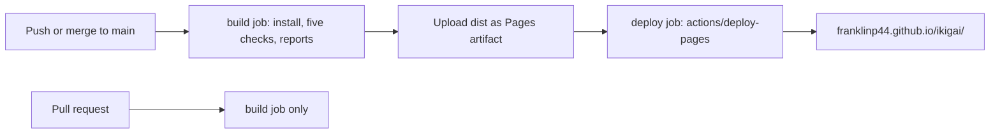

# Deployment

The site, Factory wiki refresh, and Confluence publisher use independent GitHub Actions workflows.

Active contributors: FranklinP44

## Purpose

This page covers workflow triggers, validation order, deployment, and wiki publishing. `.github/workflows/deploy-pages.yml` validates and builds the app, then publishes non-PR runs to https://franklinp44.github.io/ikigai/. For the incremental documentation lifecycle, see [Wiki refresh](features/wiki-refresh.md).

## Push to live



## The Pages workflow

`.github/workflows/deploy-pages.yml` is named "Build and deploy to GitHub Pages" in the Actions tab.

**Triggers**

| Event | Build | Deploy |
| --- | --- | --- |
| `push` to `main` | Yes | Yes |
| `pull_request` (any branch) | Yes | No |
| `workflow_dispatch` (manual) | Yes | Yes, from the branch you pick |

**Jobs**

1. `build` runs on ubuntu-latest in this exact order:
   1. `actions/checkout@v7`.
   2. `actions/setup-node@v7`, Node 22 with npm caching.
   3. `npm ci`.
   4. `npm run check:agents-md`.
   5. `npm run lint`.
   6. `npm run format:check`.
   7. `npm run test:coverage`.
   8. `npm run test:durations`, if not cancelled.
   9. `actions/upload-artifact@v7`, if not cancelled: uploads `reports/` and `coverage/` as `test-reports`, ignoring missing files.
   10. `npm run build` (`tsc --noEmit && vite build`).
   11. `actions/upload-pages-artifact@v5` uploads `dist/` only on non-PR runs.
2. `deploy` is skipped on PRs and needs successful `build`. It runs `actions/deploy-pages@v5` in the `github-pages` environment, whose URL points to the deployed page.

The five gates are instructions, lint, formatting, coverage, and build. Reporting/upload can run after a preceding failure, but early failures may leave no reports. Browser behavior still needs the [manual checklist](how-to-contribute/testing.md).

**Permissions and concurrency**

- The workflow requests `contents: read`, `pages: write`, and `id-token: write`. The last two are what `actions/deploy-pages` needs to publish.
- Runs are grouped by `pages-${{ github.ref }}` with `cancel-in-progress: true`, so a newer push to the same branch cancels an older run that is still going.

**Repository setting**

Under Settings > Pages, "Build and deployment" source must be "GitHub Actions". If it is set to "Deploy from a branch", Pages serves the raw repository files instead, and `index.html` would try to load the browser URL `"/src/main.ts"` directly, which browsers cannot run.

## Why `base: './'`

The site lives under a subpath, `/ikigai/`, not at the domain root. By default Vite writes absolute asset URLs such as `/assets/index-<hash>.js`, which would resolve to `https://franklinp44.github.io/assets/...` and return 404, leaving a blank page.

`vite.config.ts` sets `base: './'`, so the built `dist/index.html` references `./assets/index-<hash>.js` and `./assets/index-<hash>.css`. Relative URLs work under any subpath, including `/ikigai/` and `npm run preview` at the root. If the repository is renamed, nothing in the config has to change.

## Pull requests

On a normal PR, validation and test-report upload run, but the Pages artifact upload and `deploy` job are skipped. A green check covers the five gates, not browser behavior. The rolling wiki PR created with the built-in GitHub token does not trigger this workflow or the Confluence PR dry run.

## Redeploying

- **Push or merge to `main`.** Any push triggers a build and deploy.
- **Run it manually.** In the Actions tab, open "Build and deploy to GitHub Pages" and choose "Run workflow", or from the terminal:

  ```bash
  gh workflow run "Build and deploy to GitHub Pages" -R FranklinP44/ikigai --ref main
  ```

  Running it from a branch other than `main` deploys that branch to the live site, so use `main` unless you mean to.

## Rolling back

Revert the bad commit on `main` and push (or merge a revert PR). The push triggers a normal build and deploy of the reverted code:

```bash
git revert <commit-sha>
git push origin main
```

For a merge commit, add `-m 1` to `git revert`. Re-running an older workflow run from the Actions tab also redeploys that commit's build, but the next push to `main` replaces it, so a revert is the reliable option.

## Refreshing the Factory wiki

`.github/workflows/droid-wiki-refresh.yml` runs on pushes to `main` except pushes changing only `droid-wiki/**`. It has read-only workflow permissions and a repository-wide concurrency group with cancellation disabled.

- `wiki-refresh` checks out full history with `actions/checkout@v7`, restores the previous wiki from `factory/droid-wiki` when available, installs Droid, and generates/uploads to Factory only. The prompt explicitly disables GitHub wiki sync and video; the Droid settings disable `wiki-video-gen`, and a guard fails if `droid-wiki/video` exists.
- This read-only job hands pages and hidden metadata to the publishing job via `actions/upload-artifact@v7`. The `droid-wiki` artifact lasts one day and excludes images and video.
- `wiki-publish` alone receives `contents: write` and `pull-requests: write`. It uses `actions/checkout@v7`, `actions/download-artifact@v8`, and `peter-evans/create-pull-request` pinned to `5f6978faf089d4d20b00c7766989d076bb2fc7f1` (v8.1.1).
- It opens or updates the rolling `factory/droid-wiki` PR titled `docs: refresh wiki`, targeting the repository default branch and limiting commits to wiki paths, excluding images/video. PR creation failure is non-fatal and emits a warning because Factory upload has already happened.

`FACTORY_API_KEY` is required for generation. GitHub Actions must be allowed to create PRs, and branch rules must allow updating the rolling branch. The PR uses the built-in GitHub token, so it runs no other workflows: inspect and validate the diff before merging. Merging wiki-only changes avoids another refresh, but independently triggers Confluence publication below. Detailed lifecycle and editing caveats are in [Wiki refresh](features/wiki-refresh.md).

## Publishing the wiki to Confluence

`.github/workflows/publish-wiki-to-confluence.yml` ("Publish wiki to Confluence") runs `.github/scripts/publish_confluence.py`, which converts each page in `droid-wiki/` to Confluence storage format, renders Mermaid blocks to PNG with mermaid-cli, and creates or updates one Confluence page per file under a root page (default title "Ikigai wiki"). Pages are published in the order listed in `pageOrder` in `droid-wiki/.wiki-meta.json`, and only pages listed there are published.

**Triggers**

| Event | Mode |
| --- | --- |
| `push` to `main` touching `droid-wiki/**`, `.github/scripts/**`, or the workflow file | Publish |
| `pull_request` touching the same paths | Dry run |
| `workflow_dispatch` | Publish, or dry run if the `dry_run` input is checked |

A dry run converts pages and renders diagrams into `build/confluence/` without writing to Confluence. If credentials are present, it also authenticates and checks the space read-only. Every run uploads `build/confluence/` as the `confluence-preview` artifact (kept 14 days). Real publishes share one concurrency group and never cancel each other, so two runs cannot write at the same time.

The job uses read-only repository permissions and runs in this order: `actions/checkout@v7`, configuration validation, `actions/setup-python@v7` (Python 3.12, pip caching), `actions/setup-node@v7` (Node 20), global installation of `@mermaid-js/mermaid-cli@11`, installation from `.github/scripts/requirements.txt`, then the Python publisher. `actions/upload-artifact@v7` runs with `always()` to collect any generated preview files, ignoring missing output.

This workflow is independent of the Factory upload: merging the rolling PR changes `main`, which invokes a real Confluence publish. It is not a publish step inside wiki refresh.

**Configuration** (Settings > Secrets and variables > Actions)

| Name | Kind | Required | Purpose |
| --- | --- | --- | --- |
| `CONFLUENCE_URL` | Variable | Yes | Confluence site URL |
| `CONFLUENCE_SPACE_KEY` | Variable | Yes | Target space key |
| `CONFLUENCE_EMAIL` | Secret | Yes | Atlassian account email |
| `CONFLUENCE_API_TOKEN` | Secret | Yes | API token for that account |
| `CONFLUENCE_ROOT_TITLE` | Variable | No | Root page title (default "Ikigai wiki") |
| `CONFLUENCE_PARENT_ID` | Variable | No | Parent page for the root (default: space homepage) |

A real publish fails if any required value is missing. A dry run only warns and skips the Confluence checks. The workflow checks whether values are set but never prints them; keep it that way, and never echo the email or token in logs or commit them to the repo.

To try the conversion locally, run `python .github/scripts/publish_confluence.py --dry-run` from the repository root after installing `.github/scripts/requirements.txt` and mermaid-cli. Output goes to `build/`, which is gitignored.

For local environment loading, follow `README.md` and `.env.example`; the publisher does not load `.env` itself. Diagram rendering uses `.github/scripts/puppeteer-config.json` with `--no-sandbox`. Edits made only in Confluence are overwritten by later publication. Removed wiki pages are not automatically deleted from Confluence.

## Droid workflows

`.github/workflows/droid-review.yml` uses `actions/checkout@v7` and `Factory-AI/droid-action@main` for code and shallow security review. Its job requires a non-draft PR with `droid-review`; relevant new commits and lifecycle events rerun review while labeled. `.github/workflows/droid.yml` uses the same action versions for mention-driven `@droid` handling. These are distinct from validation, Pages, and wiki publishing.

## Key source files

| File | Role |
| --- | --- |
| `.github/workflows/deploy-pages.yml` | Builds on every PR and push; deploys `main` to GitHub Pages |
| `vite.config.ts` | Sets `base: './'` so asset URLs work under `/ikigai/` |
| `package.json` | Defines `npm run build` (`tsc --noEmit && vite build`) used by CI |
| `package-lock.json` | Pins dependency versions for `npm ci` |
| `.github/workflows/droid-wiki-refresh.yml` | Read-only generation and separate rolling-PR job |
| `.github/workflows/publish-wiki-to-confluence.yml` | Publishes or dry-runs `droid-wiki/` to Confluence |
| `.github/scripts/publish_confluence.py` | Markdown to Confluence conversion, diagram rendering, page sync |
| `.github/scripts/requirements.txt` | Python dependencies for the publisher |
| `.github/scripts/puppeteer-config.json` | Puppeteer flags (`--no-sandbox`) for mermaid-cli |

## Related pages

- [How to contribute](how-to-contribute/index.md)
- [Tooling](how-to-contribute/tooling.md)
- [Configuration](reference/configuration.md)
- [Wiki refresh](features/wiki-refresh.md)
- [Trust boundaries](security.md)
