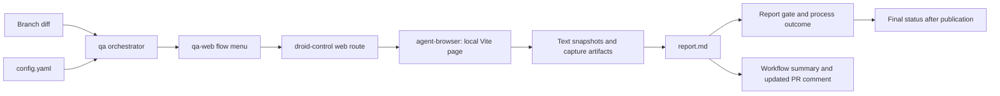

# Functional QA

Active contributors: FranklinP44

## Purpose

Functional QA checks the branch's page through real browser interactions as an anonymous visitor. It complements the required static checks and unit tests without replacing them. `.factory/skills/qa/SKILL.md` selects work from the diff, `.factory/skills/qa-web/SKILL.md` describes expected behavior, and `.github/workflows/qa.yml` runs the optional CI job.

The fixed Playwright suite is separate: `e2e/diagram.spec.ts` has eight expanded Chromium cases for load, five pills, Passion hover/leave, and Tab/Enter. `.github/workflows/e2e.yml` runs it on PRs except wiki-only changes, without a QA label, Factory secret, or Factory credits. It does not cover this skill menu's click-to-pin, all-zone hover probes, console checks, Space activation, or narrow layouts. See [Testing](../how-to-contribute/testing.md#playwright-end-to-end-tests) for runner setup and limits.

## Layout and responsibilities

This subsystem has two project skills, one shared configuration, one report template, project plugin settings, one workflow, and separate browser provisioning, execution, and report-gate scripts. Contributor attribution comes from `origin/main` history for these paths, excluding bots.



The orchestrator owns environment selection, diff mapping, evidence, and report semantics. The web skill owns what to test, probe coordinates, timing, and known failure modes. The external `droid-control@factory-plugins` plugin owns browser mechanics through its browser-use route, plus Capture and Verify. `.factory/settings.json` registers the `Factory-AI/factory-plugins` GitHub marketplace and enables that plugin. `scripts/provision-qa-browser.sh` prepares the driver and managed Chrome before the model runs; `scripts/run-qa.sh` preserves that environment and owns session cleanup; `scripts/check-qa-report.mjs` validates the report independently of the agent.

## Selecting the work

`.factory/skills/qa/SKILL.md` uses the caller's diff base, otherwise `origin/main`, and compares `<base>...HEAD`. Local runs also include tracked uncommitted changes with `git diff --name-only HEAD`.

The `web` app in `.factory/skills/qa/config.yaml` matches `index.html`, `src/**`, `vite.config.ts`, `tsconfig.json`, `package.json`, and `package-lock.json`. It excludes `src/**/*.test.ts`. Documentation, workflow/skill files, `scripts/**`, and `vitest.config.ts` do not map to an app. A diff with no app matches produces exactly this single row, without loading app skills or running their pre-flight checks:

```markdown
| # | Test Case | App | Persona | Result | Notes |
| --- | --- | --- | --- | --- | --- |
| 1 | No app code changed -- QA not applicable for this diff. | N/A | N/A | :grey_question: INCONCLUSIVE | No browser validation performed. |
```

An accepted no-app-diff report is not successful browser or application validation. Installing the browser and opening `about:blank` prove only tooling readiness. QA-tooling-only changes need separately authorized, targeted browser QA before anyone claims application validation; the diff-based run does not grant that authority.

For an affected app, run only relevant menu flows and adjacent integration checks, then add diff-specific tests when the menu does not cover the change. At least half the tests must directly verify the behavioral change. Include a related boundary or error-path check. Do not invent permission tests: the configured `visitor` has no login, account, credentials, or restricted actions.

| Change | Relevant menu flows in `.factory/skills/qa-web/SKILL.md` |
| --- | --- |
| Zone content in `src/data.ts` | Hover and Explore pills for changed zones; initial load if the center changes |
| Geometry in `src/geometry.ts` or `index.html` | All 13 zone probe points, both outside points, and click-to-pin |
| Controller in `src/main.ts` | Load, hover, pin, pills, keyboard, focused on changed behavior; built page |
| Markup in `index.html` | Load and built page; pills and keyboard if those controls change |
| Styling in `src/styles.css` | Load and narrow layout/taps; hover if active styles change |
| Build/package configuration | Built page, then initial load |

The seven flows cover initial state, hover, pinning, Explore pills, keyboard selection, console/built-page checks, and narrow layout/taps. Expected text is read afresh from the branch's `src/data.ts`. Probe points must be rechecked against `src/geometry.ts` when geometry changes. See [Zone exploration](zone-exploration.md) and [Zone keys](../primitives/zone-keys.md) for the behavior under test.

## Real interactions and server lifecycle

The web skill requires real pointer movement, clicks, and key presses through droid-control. Read-only JavaScript may inspect state or convert SVG probe points to viewport coordinates; it must not call application handlers or dispatch synthetic events. Wait for the panel's `swap` class to clear after the 140 ms content delay, or at least 400 ms, before assertions. Initial label captures wait about two seconds.

There are no hosted branch previews. `.factory/skills/qa/config.yaml` defaults to `local`, http://localhost:5173. The web skill installs packages with `npm ci` if needed, starts `npm run dev -- --strictPort`, and polls for HTTP 200 for up to 60 seconds. A server already answering in CI is a BLOCKED port conflict; outside CI it may be reused with a note that it may serve a different working tree.

The built-page flow runs `npm run build`, then `npm run preview -- --strictPort` at http://localhost:4173. A build failure is FAIL for that flow, not a standalone static-check result. Built HTML must be served over HTTP, not opened from disk. Stop every server started by the run, including Vite child processes, and confirm its ports stop answering. Do not kill a server reused from outside the run.

CI always uses local plus the built-page preview. A local startup failure is BLOCKED, never permission to test production. The config reserves production for an explicitly requested read-only smoke check outside PR/CI. QA creates no application data, so there is no data-cleanup task.

## Starting a run

Locally, ask Droid to run the `qa` skill against http://localhost:5173 from the repository. The skills manage their servers. Do not substitute lint, type checking, unit tests, coverage, or other static analysis for functional checks.

`.github/workflows/qa.yml` runs on `workflow_dispatch` or eligible PR `labeled`, `synchronize`, `reopened`, and `ready_for_review` events. PRs must be non-draft and carry `qa`; a labeled event must add that exact label. Dependabot actors are excluded, and wiki-only PR changes are path-ignored. Manual dispatch compares the dispatched ref with the default branch.

Concurrency is job-level, grouped by workflow and PR number or ref, with cancellation enabled. A job skipped by the label gate does not cancel an active run. The Ubuntu job uses Node 24 for QA tooling only, full checkout history, `npm ci`, and the Factory CLI installer. Build and Playwright jobs remain on Node 22; the app's Node support floor is unchanged. Its timeout is 25 minutes; the agent step has 20 minutes. It is informational, not a required merge check unless an administrator configures it as required.

### Provisioned browser and owned sessions

`scripts/provision-qa-browser.sh` requires `FACTORY_API_KEY`, adds the Factory plugin marketplace, installs `droid-control@factory-plugins` at project scope, and verifies it appears in the active project plugin list. It globally installs the exact driver `agent-browser@0.37.1` and checks the reported version; it does not leave driver installation or upgrades to the model.

Provisioning clears all inherited `AGENT_BROWSER_*` variables so provider, CDP, profile, saved-state, and attachment overrides cannot select another browser. It writes an isolated empty JSON config under the runner's temporary directory, then runs the pinned driver's `install --with-deps`. Exactly one executable must match the managed Chrome cache pattern `$HOME/.agent-browser/browsers/chrome-*/chrome`; an absent or ambiguous cache fails provisioning rather than falling back to system Chrome. The script prints Chrome's version, opens `about:blank` in its own `qa-bootstrap-<run-id>-<attempt>` session, checks the URL, and closes only that session on exit. A failed close also makes otherwise successful provisioning fail.

The script exports three absolute paths through GitHub's environment file: `QA_AGENT_BROWSER`, `QA_BROWSER_CONFIG`, and `QA_BROWSER_EXECUTABLE_PATH`. `scripts/run-qa.sh` validates these paths and the driver's exact version, clears inherited `AGENT_BROWSER_*` overrides again, and restores only the provisioned config/browser plus the owned `qa-<run-id>-<attempt>` session. Every browser command must use the absolute `QA_AGENT_BROWSER` executable and preserve those settings. Bare `agent-browser`, `npx`, system Chrome, CDP/auto-connect attachment, tool upgrades, and closing other sessions are forbidden.

The runner invokes Droid non-interactively and captures output through `tee` with `pipefail`, so logging cannot hide a failed agent process. Exit and signal traps close only the owned session, with a 15-second timeout; cleanup failure changes an otherwise successful process to failure. The agent separately stops only dev/preview servers it started.

## Reports and evidence

`.factory/skills/qa/REPORT-TEMPLATE.md` defines a concise results table, optional Action Required section, and one collapsed evidence block. Results are PASS, FAIL, BLOCKED, FLAKY, or INCONCLUSIVE. Setup work is not a test row. Incomplete flows must be reported with what was tried and remediation, never silently omitted.

`scripts/check-qa-report.mjs` exports `evaluateQaReport` and `checkQaReportFile` and also runs as the CLI gate. It requires `## QA Report` first, followed immediately (apart from blank lines) by one contiguous results table with the exact six columns `#`, `Test Case`, `App`, `Persona`, `Result`, and `Notes`. The table needs a valid separator, at least one complete row, and unique positive safe-integer IDs. Missing/unreadable/empty reports, unresolved template placeholders, malformed or fragmented tables, missing required cells, unknown statuses, and mismatched status markers fail closed.

Only actual Result cells in that main table determine test status; FAIL/BLOCKED words in Notes, the normal legend, prose, or evidence do not. Both FAIL and BLOCKED fail the gate. FLAKY alone is accepted, not proof of a clean pass. INCONCLUSIVE is accepted only as the exact single no-app-diff row above, including its ID, punctuation, N/A cells, and Notes. A non-success QA process outcome still fails a structurally valid report containing only PASS rows or the no-app-diff row. `scripts/check-qa-report.test.ts` covers these parsing and process/CLI regressions in the normal Vitest checks; see [Testing](../how-to-contribute/testing.md).

The skill writes `qa-results/report.md` and stores run-specific evidence in `qa-results/<RUN_ID>/`. Text snapshots are primary evidence. Screenshots are downloadable artifacts by default, not broken inline image links. `.gitignore` excludes `qa-results/`.

The agent and report-validation steps both use `continue-on-error` so their recorded outcomes do not prevent evidence publication. Unless cancelled, the workflow uploads `qa-results/`, `qa-output.txt`, and provisioning diagnostics (plugin list, driver version, bootstrap URL) as the `qa-results` artifact for 14 days, adds a job summary, and updates one bot comment identified by `<!-- qa-report -->`. A missing report produces a fallback comment with the end of the agent log; manual runs have no PR comment. Only after publication does the final step fail if either the QA process or the report gate outcome is not `success`. A green workflow can still mean FLAKY or accepted no-app-diff results, not that all browser flows passed.

Current `.factory/skills/qa/config.yaml` sets `imagemagick: false`, `video_evidence: false`, and `droid_control.compose: false`. CI forbids video and Compose: the workflow rejects either config value unless it is explicitly `false`, and the runner rejects non-false `VIDEO_EVIDENCE` or `COMPOSE` values. The CI prompt forbids recording, rendering, and uploading video. Capture and Verify still apply to affected-app runs using text/screenshot evidence; enabling either video toggle is not a supported CI option.

The skill retains optional non-CI video/Compose and inline-upload instructions, but these do not override the CI restrictions. Optional inline evidence upload needs `QA_EVIDENCE_TOKEN`; `.github/workflows/qa.yml` does not currently wire it or `REPO_ID` into the agent step. Without it, the skill uses text and workflow artifacts. Do not enable video merely to run QA or to refresh this wiki.

## Setup and modification entry points

`FACTORY_API_KEY` is a repository secret for the CI agent, not browser authentication. Fork PRs do not receive it and the workflow reports the missing-secret error. The job has `contents: read` and `pull-requests: write` for checkout and comment publication. Review changes to the skills, plugin settings, and workflow as automation inputs; see [Trust boundaries](../security.md).

Change environment URLs, matching, evidence toggles, and personas in `.factory/skills/qa/config.yaml`; change orchestration/report rules in `.factory/skills/qa/SKILL.md`; change flow expectations and environment failure notes in `.factory/skills/qa-web/SKILL.md`. `failure_learning: suggest_in_report` suggests new environment insights without editing the skill or producing an automatic patch file. `.factory/skills/qa/.install-progress.yaml` is installer bookkeeping, not runtime configuration.

The app entry declares `test_tool: agent-browser` and `build_command: "npm run build"` but no `dev_command` or `port`. QA startup is documented in the web skill; generic wiki screenshot discovery cannot infer an eligible app from this entry alone. Exact settings are in [Configuration](../reference/configuration.md).

## Key source files

| File | Role |
| --- | --- |
| `.factory/skills/qa/SKILL.md` | Diff-aware orchestrator and report/evidence rules |
| `.factory/skills/qa/config.yaml` | Environments, visitor persona, app matching, evidence toggles |
| `.factory/skills/qa/REPORT-TEMPLATE.md` | Result table and collapsed evidence format |
| `.factory/skills/qa-web/SKILL.md` | Seven browser flow definitions and local server lifecycle |
| `.factory/settings.json` | Plugin marketplace registration and activation |
| `.github/workflows/qa.yml` | Optional label-gated execution, artifacts, comments, final status |
| `scripts/provision-qa-browser.sh` | Project plugin activation, pinned driver, isolated config, managed Chrome, bootstrap check |
| `scripts/run-qa.sh` | Validates provisioned paths, runs the agent with pipefail, cleans up the owned session |
| `scripts/check-qa-report.mjs` | Parses the main result table and fails closed on report/process failures |
| `scripts/check-qa-report.test.ts` | Regression tests for report parsing, exact no-app-diff acceptance, and CLI outcomes |
| `.gitignore` | Keeps local QA results out of ordinary additions |
| `e2e/diagram.spec.ts`, `playwright.config.ts`, `.github/workflows/e2e.yml` | Separate fixed browser suite, not part of agent QA orchestration |
