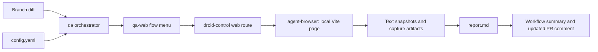

# Functional QA

Active contributors: FranklinP44

## Purpose

Functional QA checks the branch's page through real browser interactions as an anonymous visitor. It complements the required static checks and unit tests without replacing them. `.factory/skills/qa/SKILL.md` selects work from the diff, `.factory/skills/qa-web/SKILL.md` describes expected behavior, and `.github/workflows/qa.yml` runs the optional CI job.

## Layout and responsibilities

This subsystem has two project skills, one shared configuration, one report template, project plugin settings, and one workflow. Contributor attribution comes from `origin/main` history for these paths, excluding bots.

The orchestrator owns environment selection, diff mapping, evidence, and report semantics. The web skill owns what to test, probe coordinates, timing, and known failure modes. The external `droid-control@factory-plugins` plugin owns browser mechanics through its browser-use route, plus Capture and Verify. `.factory/settings.json` registers the `Factory-AI/factory-plugins` GitHub marketplace and enables that plugin.

## Selecting the work

`.factory/skills/qa/SKILL.md` uses the caller's diff base, otherwise `origin/main`, and compares `<base>...HEAD`. Local runs also include tracked uncommitted changes with `git diff --name-only HEAD`.

The `web` app in `.factory/skills/qa/config.yaml` matches `index.html`, `src/**`, `vite.config.ts`, `tsconfig.json`, `package.json`, and `package-lock.json`. It excludes `src/**/*.test.ts`. Documentation, workflow/skill files, `scripts/**`, and `vitest.config.ts` do not map to an app. A diff with no app matches produces one INCONCLUSIVE row, "No app code changed -- QA not applicable for this diff", without loading app skills or running their pre-flight checks.

For an affected app, run only relevant menu flows and adjacent integration checks, then add diff-specific tests when the menu does not cover the change. At least half the tests must directly verify the behavioral change. Include a related boundary or error-path check. Do not invent permission tests: the configured `visitor` has no login, account, credentials, or restricted actions.

| Change | Relevant menu flows in `.factory/skills/qa-web/SKILL.md` |
| --- | --- |
| Zone content in `src/data.ts` | Hover and Explore pills for changed zones; initial load if the center changes |
| Geometry in `src/geometry.ts` or `index.html` | All 13 zone probe points, both outside points, and click-to-pin |
| Controller in `src/main.ts` | Load, hover, pin, pills, keyboard, focused on changed behavior; built page |
| Markup in `index.html` | Load and built page; pills and keyboard if those controls change |
| Styling in `src/styles.css` | Load and narrow layout/taps; hover if active styles change |
| Build/package configuration | Built page, then initial load |

The seven flows cover initial state, hover, pinning, Explore pills, keyboard selection, console/built-page checks, and narrow layout/taps. Expected text is read afresh from the branch's `src/data.ts`. Probe points must be rechecked against `src/geometry.ts` when geometry changes. See [Zone exploration](zone-exploration.md) and [Zone keys](../primitives/zone-keys.md) for the behavior under test.

## Real interactions and server lifecycle

The web skill requires real pointer movement, clicks, and key presses through droid-control. Read-only JavaScript may inspect state or convert SVG probe points to viewport coordinates; it must not call application handlers or dispatch synthetic events. Wait for the panel's `swap` class to clear after the 140 ms content delay, or at least 400 ms, before assertions. Initial label captures wait about two seconds.

There are no hosted branch previews. `.factory/skills/qa/config.yaml` defaults to `local`, http://localhost:5173. The web skill installs packages with `npm ci` if needed, starts `npm run dev -- --strictPort`, and polls for HTTP 200 for up to 60 seconds. A server already answering in CI is a BLOCKED port conflict; outside CI it may be reused with a note that it may serve a different working tree.

The built-page flow runs `npm run build`, then `npm run preview -- --strictPort` at http://localhost:4173. A build failure is FAIL for that flow, not a standalone static-check result. Built HTML must be served over HTTP, not opened from disk. Stop every server started by the run, including Vite child processes, and confirm its ports stop answering. Do not kill a server reused from outside the run.

CI always uses local plus the built-page preview. A local startup failure is BLOCKED, never permission to test production. The config reserves production for an explicitly requested read-only smoke check outside PR/CI. QA creates no application data, so there is no data-cleanup task.

## Starting a run

Locally, ask Droid to run the `qa` skill against http://localhost:5173 from the repository. The skills manage their servers. Do not substitute lint, type checking, unit tests, coverage, or other static analysis for functional checks.

`.github/workflows/qa.yml` runs on `workflow_dispatch` or eligible PR `labeled`, `synchronize`, `reopened`, and `ready_for_review` events. PRs must be non-draft and carry `qa`; a labeled event must add that exact label. Dependabot actors are excluded, and wiki-only PR changes are path-ignored. Manual dispatch compares the dispatched ref with the default branch.

Concurrency is job-level, grouped by workflow and PR number or ref, with cancellation enabled. A job skipped by the label gate does not cancel an active run. The Ubuntu job uses Node 22, full checkout history, `npm ci`, and the Factory CLI installer. Its timeout is 25 minutes; the agent step has 20 minutes. It is informational, not a required merge check unless an administrator configures it as required.

## Reports and evidence

`.factory/skills/qa/REPORT-TEMPLATE.md` defines a concise results table, optional Action Required section, and one collapsed evidence block. Results are PASS, FAIL, BLOCKED, FLAKY, or INCONCLUSIVE. Setup work is not a test row. Incomplete flows must be reported with what was tried and remediation, never silently omitted.

The skill writes `qa-results/report.md` and stores run-specific evidence in `qa-results/<RUN_ID>/`. Text snapshots are primary evidence. Screenshots are downloadable artifacts by default, not broken inline image links. `.gitignore` excludes `qa-results/`.

The workflow continues after an agent-step failure to upload `qa-results/` plus `qa-output.txt` as the `qa-results` artifact for 14 days, add a job summary, and update one bot comment identified by `<!-- qa-report -->`. Manual runs have no PR comment. Its final step fails if the agent step failed, the report is absent/empty, or a table row has the template's FAIL marker. BLOCKED, FLAKY, and INCONCLUSIVE rows alone do not fail that final check; a green workflow is not proof that all flows passed.

Current `.factory/skills/qa/config.yaml` sets `imagemagick: false`, `video_evidence: false`, and `droid_control.compose: false`. Capture and Verify still run, but no video recording or Compose is requested. Enabling video records one flow per video; Compose runs only when both video and Compose are enabled. Raw WebM is retained when Compose is off. Compose output uses the Factory preset and a maximum 60-second MP4.

Optional inline evidence upload needs `QA_EVIDENCE_TOKEN`; `.github/workflows/qa.yml` does not currently wire it or `REPO_ID` into the agent step. Without it, the skill uses text and workflow artifacts. Do not enable video merely to run QA or to refresh this wiki.

## Setup and modification entry points

`FACTORY_API_KEY` is a repository secret for the CI agent, not browser authentication. Fork PRs do not receive it and the workflow reports the missing-secret error. The job has `contents: read` and `pull-requests: write` for checkout and comment publication. Review changes to the skills, plugin settings, and workflow as automation inputs; see [Trust boundaries](../security.md).

Change environment URLs, matching, evidence toggles, and personas in `.factory/skills/qa/config.yaml`; change orchestration/report rules in `.factory/skills/qa/SKILL.md`; change flow expectations and environment failure notes in `.factory/skills/qa-web/SKILL.md`. `failure_learning: suggest_in_report` suggests new environment insights without editing the skill or producing an automatic patch file. `.factory/skills/qa/.install-progress.yaml` is installer bookkeeping, not runtime configuration.

The app entry declares `test_tool: agent-browser` and `build_command: "npm run build"` but no `dev_command` or `port`. QA startup is documented in the web skill; generic wiki screenshot discovery cannot infer an eligible app from this entry alone. Exact settings are in [Configuration](../reference/configuration.md).

## Key source files

| File | Role |
| --- | --- |
| `.factory/skills/qa/SKILL.md` | Diff-aware orchestrator and report/evidence rules |
| `.factory/skills/qa/config.yaml` | Environments, visitor persona, app matching, evidence toggles |
| `.factory/skills/qa/REPORT-TEMPLATE.md` | Result table and collapsed evidence format |
| `.factory/skills/qa-web/SKILL.md` | Seven browser flow definitions and local server lifecycle |
| `.factory/settings.json` | Plugin marketplace registration and activation |
| `.github/workflows/qa.yml` | Optional label-gated execution, artifacts, comments, final status |
| `.gitignore` | Keeps local QA results out of ordinary additions |
