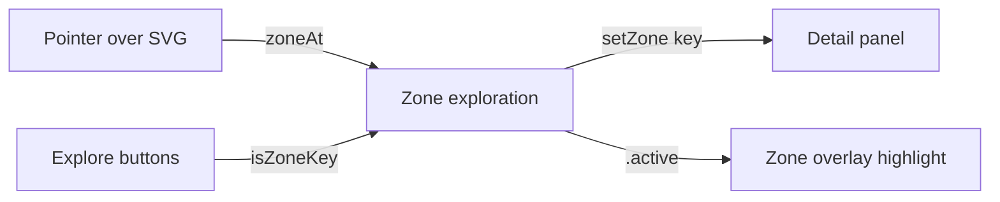

# Features

The app has two user-facing features. Both live in `src/main.ts` and share the same state (`current` and `pinned`). Their content comes from `src/data.ts`, and hit testing comes from `src/geometry.ts`.

The repository also has developer-facing wiki refresh and functional QA workflows in `.github/workflows/droid-wiki-refresh.yml` and `.github/workflows/qa.yml`. They run separately from the browser app. QA uses Node 24 only for its tooling, provisions pinned `agent-browser@0.37.1` with managed Chrome in isolated owned sessions, and publishes text/screenshot evidence before propagating process or report-gate failures. FAIL and BLOCKED Result cells both fail the check; CI forbids video and Compose.

An exact no-app-diff INCONCLUSIVE report can be accepted without browser validation. Provisioning alone is not application validation; QA-tooling-only changes require separately authorized targeted browser QA before making that claim. See [Functional QA](functional-qa.md) for the report contract and [Configuration](../reference/configuration.md) for environment and evidence settings.

The fixed browser suite in `e2e/diagram.spec.ts` and `.github/workflows/e2e.yml` checks the built page independently of diff-targeted QA. It is documented in [Testing](../how-to-contribute/testing.md), rather than as a separate app feature.

| Feature | What it does | Page |
| --- | --- | --- |
| Zone exploration | Hovers, taps, or clicks regions of the diagram, or presses an Explore button | [Zone exploration](zone-exploration.md) |
| Detail panel | Reads the eyebrow, title, description, circle chips, and examples for the active zone | [Detail panel](detail-panel.md) |
| Wiki refresh | Updates documentation in Factory and prepares a rolling pull request | [Wiki refresh](wiki-refresh.md) |
| Functional QA | Selects branch-local browser checks from a diff, isolates the browser, and gates reports independently of agent success | [Functional QA](functional-qa.md) |

The visual building blocks these features depend on are covered under [Systems](../systems/index.md).
