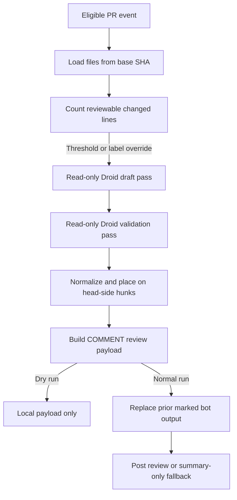

# PR walkthrough

Active contributors: FranklinP44

## Purpose

The PR walkthrough explains what a change does and where a human reviewer should spend attention. `.github/workflows/droid-walkthrough.yml` runs two Droid passes, then posts an explanatory GitHub review. It is separate from bug/security review and application tests; its Core, Notable, and Minor tiers describe reviewer attention, not defect severity.

## Key source files

| File | Purpose |
| --- | --- |
| `.github/workflows/droid-walkthrough.yml` | Event gates, trusted-file loading, CLI installation, and pass/post orchestration |
| `.github/droid-walkthrough/config.json` | Size threshold, exclusions, attention rubric, placement limits, and model options |
| `.github/droid-walkthrough/pass1-candidates.md` | Draft summary, reading order, and code-block explanations |
| `.github/droid-walkthrough/pass2-validate.md` | Check claims, placement, tiers, and duplication |
| `.github/droid-walkthrough/walkthrough.py` | Python standard-library driver for sizing, model output, placement, and GitHub posting |

The subsystem has five implementation/configuration/prompt files and no dedicated walkthrough tests in the current tree. The contributor byline combines `.github/CODEOWNERS` with recent human history on `origin/main`, using the owner's GitHub username.

## When it runs

`.github/workflows/droid-walkthrough.yml` listens only to pull-request `opened`, `ready_for_review`, `reopened`, and `labeled` events. It has **no `synchronize` or `workflow_dispatch` trigger**: pushing another commit alone does not refresh the walkthrough. A labeled event must add `droid-walkthrough`; other label additions are ignored. Every run also requires a non-draft PR whose head repository is this repository, so the label does not enable fork or draft runs.

`cmd_size()` in `.github/droid-walkthrough/walkthrough.py` counts added plus deleted lines from a three-dot, no-renames numstat diff. The default threshold is **150 countable lines**, including exactly 150. Binary files contribute zero, and excluded paths do not count. `is_excluded()` matches configured globs against both the full path and basename. `.github/droid-walkthrough/config.json` excludes lockfiles, minified/source-map/snapshot output, build/vendor directories, and generated-code patterns. Excluded text files remain marked as excluded in the prompts; binary files are omitted from their changed-file lists.

Adding `droid-walkthrough` bypasses the size threshold. The Python gate also recognizes an `EVENT_ACTION` value of `workflow_dispatch`, but the workflow declares no such event. The override label is removed only after actual posting on a labeled run, not after sizing, generation, or a dry run; deletion is best-effort. Re-adding it requests another run.

## How it works

The workflow checks out the exact PR head with full history and credential persistence disabled. It copies the config, both prompts, and Python driver from `BASE_SHA` into the runner's temporary directory, exported as `WT_DIR`. If any base file is missing, it skips the walkthrough. Changes to those four files therefore do not govern their own PR's walkthrough. This is a specific trusted-file boundary, not a claim that all PR content is trusted; see [Trust boundaries](../security.md).

Both prompts treat the title/body as context rather than instructions, request surrounding-code inspection, and forbid edits, builds, or posting. The driver invokes `droid exec -o json` with default read-only autonomy, without an elevated autonomy flag. Pass 1 drafts a summary and at most **40 candidates**, most important first; this is a prompt limit, not a Python truncation. Pass 2 keeps, revises, merges, or drops explanations and may add candidates only for missed Core changes.

In `.github/droid-walkthrough/walkthrough.py`, `droid()` reads the CLI JSON envelope, extracts the result object, and retries once in the same session if result JSON cannot be parsed. This is not a general retry for process failures. `record_usage()` accumulates Factory credits and turns for both passes, including JSON retries, under `WT_DIR`; the posting step includes credit usage and item counts in the Actions summary.

## Key abstractions

All functions below are in `.github/droid-walkthrough/walkthrough.py`.

| Function | Responsibility |
| --- | --- |
| `changed_files()`, `cmd_size()` | Compute countable changes and the run decision |
| `prompt_values()`, `render()` | Build prompts from PR metadata, diff inventory, and configured rubric |
| `cmd_pass1()`, `cmd_pass2()` | Write normalized candidate and validated JSON intermediates |
| `normalize()`, `as_tier()` | Coerce fields and ranges, strip a leading `./`, and normalize tiers |
| `parse_diff()`, `place()` | Map head-side diff hunks and repair or reject comment placement |
| `review_body()`, `comment_body()` | Render the overview, reading order, change table, and inline explanations |
| `replace_previous()`, `cmd_post()` | Replace marked bot output and submit a GitHub review |

### Placement and attention tiers

`normalize()` discards malformed entries without usable line numbers, path, or title, orders reversed ranges, and defaults unknown tiers to Minor. Legacy P0/P1/P2 input maps to Core/Notable/Minor for compatibility; the prompts explicitly forbid severity vocabulary in generated explanations.

`parse_diff()` includes added and context lines on the RIGHT/head side. `place()` intersects a proposed range with one hunk and limits it to **40 lines**. Deleted files and ranges without usable head-side overlap remain summary-only.

The prompts request an exact copied anchor, but enforcement is looser: `place()` collapses whitespace and accepts equality or an anchor substring of at least 12 characters. It first searches the proposed range, then searches diff lines and shifts toward the nearest match. Empty anchors can still be placed from range overlap. These checks help correct line drift; they do not prove an explanation is accurate or uniquely anchored.

`.github/droid-walkthrough/config.json` defines:

| Tier | Attention | Default output |
| --- | --- | --- |
| Core | Understand before approving: contracts, security-sensitive paths, data models, core logic, dependencies, or data handling | Inline and summary |
| Notable | Read non-trivial logic, modules, configuration, refactors, retries, or state changes | Inline and summary |
| Minor | Skim renames, copy, formatting, boilerplate, or simple wiring | Summary |

`cmd_post()` sorts placed items by tier, preserves validator order within each tier, and posts at most **15 inline comments**. Overlapping inline ranges in the same file are suppressed. Overflow, ineligible tiers, and unplaceable explanations remain in the summary's change table; excluded paths are discarded. The validator is asked to check reading-order paths, but the renderer does not independently enforce that they are changed files.

### Posting and replacement

`cmd_post()` writes a payload using GitHub review event `COMMENT`, never approval or request-changes. Bodies carry `<!-- droid-walkthrough -->` and an explanation-only marker for other automated agents.

With `replace_previous: true`, `replace_previous()` finds Bot-authored output containing the walkthrough marker. It deletes prior inline comments and rewrites prior review bodies as superseded; it does not delete the reviews themselves. Cleanup calls are best-effort and occur before the new post, so replacement is not atomic.

If GitHub rejects the review with inline positions, the driver retries with the summary and no inline comments. A failed summary-only post fails the command. After a successful post on a labeled run, it attempts to consume the override label.

## Changing or checking the feature

Start with `.github/droid-walkthrough/config.json` for thresholds, exclusions, tiers, model/reasoning settings, and output limits. Change explanatory criteria in `.github/droid-walkthrough/pass1-candidates.md` and `.github/droid-walkthrough/pass2-validate.md`; change parsing, placement, or posting in `.github/droid-walkthrough/walkthrough.py`. Event behavior belongs in `.github/workflows/droid-walkthrough.yml`.

For a local payload check, prepare `WT_DIR` with the config and validated intermediate, set `BASE_SHA` and `HEAD_SHA`, then run the driver's `post` subcommand with **`WT_DRY_RUN=1`**. It writes `$WT_DIR/payload.json` and returns before GitHub cleanup, posting, or label removal. This flag does not turn `pass1` or `pass2` into offline operations; those still invoke Droid and can consume credits. Payload checks do not replace live GitHub-position validation or claim application coverage.

See [Tooling](../how-to-contribute/tooling.md) for adjacent developer automation, [Configuration](../reference/configuration.md) for shared settings, and [Deployment](../deployment.md) for workflow permissions and execution context.
