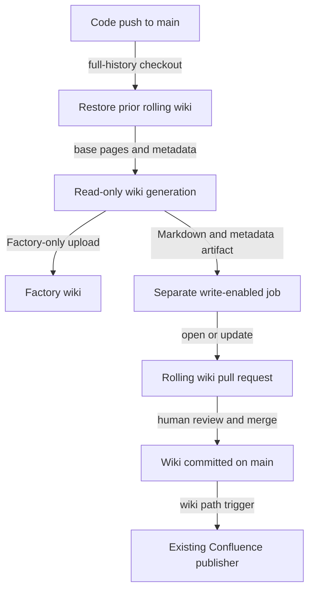

# Wiki refresh

Active contributors: FranklinP44

## Purpose

`.github/workflows/droid-wiki-refresh.yml` refreshes this wiki after code changes reach `main`. It uploads to Factory only, skips video, and hands the generated Markdown to a separate job that opens or updates one rolling pull request.

## Directory layout

```text
.github/workflows/
  droid-wiki-refresh.yml
  publish-wiki-to-confluence.yml
droid-wiki/
  .wiki-meta.json
  overview/
  features/
  systems/
  reference/
```

## Key abstractions

| Setting or component | Source | Role |
| --- | --- | --- |
| `WIKI_BRANCH` | `.github/workflows/droid-wiki-refresh.yml` | The reusable `factory/droid-wiki` branch |
| `wiki-refresh` | `.github/workflows/droid-wiki-refresh.yml` | Read-only repository job that generates pages and uploads to Factory |
| `wiki-publish` | `.github/workflows/droid-wiki-refresh.yml` | Separate GitHub-write job that updates the rolling branch and pull request |
| `commitHash`, `pageOrder` | `droid-wiki/.wiki-meta.json` | Previous source revision and ordered navigation used by incremental generation |

## How it works



The push trigger ignores changes confined to `droid-wiki/**`, so merging the wiki pull request does not start another refresh. Concurrency is repository-wide with `cancel-in-progress: false`. The workflow checks out full history, then tries to copy only `droid-wiki/` from the rolling branch. If that branch is unavailable, it keeps the pages checked out from `main`.

Before generation, the workflow adds `wiki-video-gen` to Droid's disabled skills. Its prompt explicitly says to skip video and use `--upload-to factory`, with no GitHub wiki sync. A later guard fails if `droid-wiki/video` exists. The artifact includes hidden metadata, excludes images and video, and expires after one day. These controls are all in `.github/workflows/droid-wiki-refresh.yml`.

The publish job uses the built-in GitHub token to create a pull request titled `docs: refresh wiki` and labeled `droid-wiki`. A failure to push or open the pull request becomes a warning rather than invalidating the already-generated Factory wiki.

## Integration points

The feature's implementation is one workflow file with two jobs and no adjacent unit-test file. `.github/CODEOWNERS` assigns it to the repository's one human owner. Workflow guards check the generated output; the Vitest coverage in [Testing](../how-to-contribute/testing.md) measures application modules, not this automation.

The generation job has `contents: read`; only the publish job has `contents: write` and `pull-requests: write`. `FACTORY_API_KEY` comes from an Actions secret. See [Trust boundaries](../security.md) for the credential and permission boundaries.

Pull requests created with the built-in token do not automatically trigger the repository's other workflows. `AGENTS.md` therefore asks reviewers to inspect the wiki diff before merging. Merging changes on `main` triggers `.github/workflows/publish-wiki-to-confluence.yml`; this is a separate existing publication path, not part of a Factory-only manual upload. See [Deployment](../deployment.md).

## Entry points for modification

Change triggers, upload targets, video guards, artifact filters, and pull request settings in `.github/workflows/droid-wiki-refresh.yml`. Keep `droid-wiki/.wiki-meta.json` in the artifact because the next run needs its source revision for incremental updates.

`AGENTS.md` warns that automatic refresh can rewrite hand-edited pages. Put lasting wiki changes in the rolling pull request and expect later runs to revise them when the underlying source changes.

## Key source files

| File | Purpose |
| --- | --- |
| `.github/workflows/droid-wiki-refresh.yml` | Generation, Factory upload, artifact handoff, and rolling pull request |
| `.github/workflows/publish-wiki-to-confluence.yml` | Publication of committed wiki changes to Confluence |
| `droid-wiki/.wiki-meta.json` | Source revision and sidebar ordering |
| `AGENTS.md` | Review expectations and generated-wiki maintenance rules |
